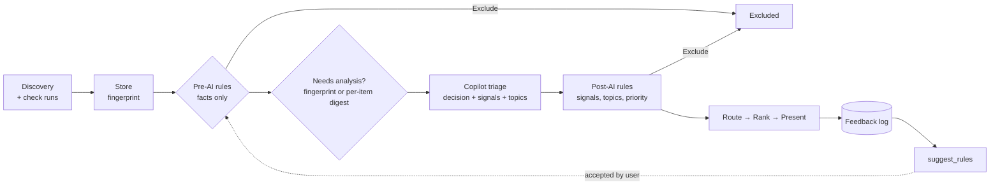

# Filtering and Prioritization v2 — Design

Status: approved for the next release. Built in ordered milestones on one branch; each milestone passes `scripts/verify-ci.sh` before the next starts.

## 1. Why

Triage's rules could not express what users actually wanted to filter, and its strongest action only demoted work.

- A rule cannot see comment text, comment authors, check names, or anything Copilot noticed, so "PRs blocked on a deployment/compliance approval" was impossible and "failing CI" was hidden behind an unsuggested field that only knew the head commit's rollup state.
- *Lower priority* (−25) keeps work in the Inbox (80 → 55). *Mute* was the only exclusion, was permanent, and was really a class-level filter with an item-level name.
- Rules were AND-only (≤ 5 conditions), first-match by list order, and a second, different filter language powered search and saved searches.
- Any rule edit re-analyzed every item. Copilot's output was free text only, so nothing could target what it recognized, and nothing learned from the user's corrections.

## 2. Decisions

| # | Decision |
|---|----------|
| 1 | AI rule suggestions use a new fixed helper operation, `suggest_rules`, following the `draft` pattern. |
| 2 | **Exclude** hides matches everywhere: its own *Excluded* section only; never in Inbox, Briefing, Review, notifications, menu bar, or sent to Copilot when excludable before analysis. |
| 3 | **Mute** and **Exclude** are separate. Mute is a per-item action that returns when you are directly addressed. Exclude is a rule action that never shows matches while the rule matches. Existing Mute rules migrate to Exclude rules. |
| 4 | Ranking effects stay, bounded (small / medium / large) and separated from routing. *Not right?* offers Exclude, Mute, and Move first. |
| 5 | Copilot returns signals from a fixed taxonomy plus user-defined **Topics**. Nothing domain-specific (e.g. FedRAMP) is hard-coded. |
| 6 | Copilot chat models only. The OpenAI Decisions API is out of scope (not exposed through Copilot). |
| 7 | Local feedback log: explicit and implicit outcomes, encrypted, 90-day retention, visible and clearable in Settings. |
| 8 | One GitHub-style query language for rules, search, and saved searches, with a visual builder. Saved searches move into the encrypted vault. |
| 9 | Deterministic check-run facts (name, conclusion, required). No deployment- or vendor-specific fetches. |
| 10 | Hybrid, explainable priority. UX must stay simple: sensible defaults, progressive disclosure, plain language. |
| 11 | Suggestions on demand (Settings ▸ Filters) plus an occasional dismissible card in Review when local evidence is strong. |
| 12 | One release, ordered milestones. |

## 3. Pipeline



Precedence is fixed and explainable: **Local status** (Done, Snooze, Mute) → **Exclude** → **Route** → **Rank**.

## 4. Query language

One parser, printer, and matcher (`TriageQuery`) used by rules, the search field, saved searches, rule previews, and suggestion validation. Text and the visual builder round-trip losslessly; the canonical printed form is what is stored.

Grammar: terms are AND-ed; `OR` between terms; parentheses group; `-` negates; quotes keep phrases; `@me` is the viewer. Free words match title, body, comments, labels, people, and Copilot's text.

| Qualifier | Values | Phase |
|---|---|---|
| `repo:` | `owner/name`, `owner/*`, `name` | facts |
| `author:` `assignee:` `commenter:` `reviewer:` `team:` | login, `@me`, `org/team` | facts |
| `label:` | name | facts |
| `is:` | `pr` `issue` `draft` `review` `direct` `team` `assigned` `mine` `mentioned` | facts |
| `is:` | `unread` `read` | local |
| `status:` | `failing` `passing` `pending` `required-failing` `conflicts` `approved` `changes` | facts |
| `check:` | check name; `check:"build":failing` | facts |
| `title:` `body:` `comment:` | text | facts |
| `updated:` `created:` | `>14d`, `<2d` | facts |
| `size:` | `>500` (additions + deletions) | facts |
| `signal:` | taxonomy value | AI |
| `topic:` | topic name | AI |
| `priority:` | `high` `medium` `low`, `>70` | AI |
| `effort:` | `quick` `short` `deep` | AI |
| `in:` | `inbox` `action` `waiting` `none` | AI |

A query's **phase** is the latest phase of any qualifier it uses. Fact-only queries run before Copilot; AI queries run after a decision exists.

Validation errors are specific and shown inline ("Unknown qualifier `stauts:` — did you mean `status:`?").

## 5. Facts

`PullRequestFacts` gains `checkRuns: [CheckRunFact]` — `name`, `conclusion` (success, failure, neutral, cancelled, timedOut, actionRequired, skipped, stale, or pending), and `isRequired` — from the head commit's `statusCheckRollup.contexts` (CheckRun and StatusContext), first 25. The overall rollup stays. Page size is tuned so a search page stays within GraphQL cost limits; the performance benchmark covers it. Check runs are part of the fingerprint and are sent to Copilot.

## 6. Signals and Topics

Copilot returns, per item:

- `signals`: zero or more values from a fixed taxonomy, defined in the prompt with precise meanings — `ci-failing`, `approval-gate` (a human approval or sign-off other than code review blocks progress), `blocked-on-you`, `question-for-you`, `security`, `release-blocker`, `deadline`, `waiting-on-author`, `bot-noise`, `stale`.
- `topics`: names of the user's Topics the item matches.

**Topics** are per organization: a short name and a plain-language description (≤ 280 bytes each, ≤ 20 per organization), e.g. *“Compliance approvals — blocked on a FedRAMP or other compliance deployment approval.”* They are sent to Copilot in a delimited, lower-precedence block like instructions; GitHub text can never add to them.

Wire changes land together in the Rust schema, the Swift Codable types, and `CopilotWireSchema`. `TriageRules.promptVersion` is bumped.

## 7. Rules

```text
TriageRule { id, name, isEnabled, query: TriageQuery, action, createdBy: user | suggestion }
action = exclude | route(needsAction | inbox | waiting | noAction) | rank(higher | lower, small | medium | large)
```

- **Exclude** wins over everything except local status. Excluded items show in *Excluded* with the rule that excluded them, and **Show Anyway** (disables nothing; opens the rule).
- **Route**: first matching route wins in list order. *Move to Inbox* never downgrades *Needs action* (as today's *Always Inbox*).
- **Rank**: weights ±10 / ±20 / ±35, summed and capped at ±40.
- Conflicts (two route rules that both match an item with different targets) are flagged in Settings.
- Limit stays 100 rules.

**Migration (lossless and automatic):** each v1 rule becomes one v2 rule. Conditions map to qualifiers (`checksFailing` → `status:failing`, `inactiveDays: 14` → `updated:>14d`, `reviewRequestedTeam` → `is:team`, …). `mute` → `exclude`; `raisePriority`/`lowerPriority` → `rank medium`; disposition effects → `route`. Saved searches move from user defaults into the vault and are then removed from user defaults.

### Re-analysis

A decision is reused while the item's fingerprint and its **per-item digest** are unchanged. The per-item digest hashes the prompt version, instructions, Topics, the re-analysis token, and the route hints that match the item. Exclude and rank rules, and rules that only match after AI, never trigger re-analysis.

## 8. Mute (per item)

`LocalStatus.muted(at:, relationships:)`. A muted item is hidden until, after `at`, someone else:

- @mentions the viewer in a comment,
- requests the viewer's review, or assigns the viewer (relationship not present at mute time), or
- submits a review requesting changes on the viewer's pull request.

Then it returns as active and unread. Muted items appear in the *Muted* section. Done (returns on any activity by others) and Snooze (returns at a time) are unchanged.

## 9. Priority

```text
score = clamp(0…100, copilotUrgency + factors + ruleWeights)
```

Factors (fixed in code, tested, each ≤ ±10, total capped at ±20):

| Factor | Effect |
|---|---|
| Review requested from you directly | +6 |
| Review requested only via a team | −6 |
| Someone has waited on you > 3 days | +4, > 7 days +8 |
| A required check is failing on your pull request | +6 |
| @mentioned since you last acted | +5 |
| No activity for 30+ days | −6 |

Bands stay High ≥ 70, Medium ≥ 40. The Inbox sorts *Needs action* first, then by score. The detail view's priority meter opens **Why this rank**: Copilot's assessment, then each factor and rule as one plain-language line with its effect.

## 10. Feedback and suggestions

**Feedback log** (`triage_feedback`, rowid table): `kind`, `node_id`, `at`, and a compact snapshot (repository, author, labels, kind, relationships, signals, topics, disposition, priority). Kinds:

- explicit: `notRight(from, to)`, `ruleCreated`, `ruleEdited`, `ruleDeleted`, `muted`, `excludedManually`;
- implicit: `doneUnopened`, `doneSoonAfterAction`, `snoozed`, `ignoredInInbox` (in the Inbox 7+ days, never opened).

Pruned after 90 days. **Settings ▸ Filters ▸ Learning** shows the count and **Clear History**.

**Candidates** are mined locally and deterministically: group feedback by single and paired facts (repository, author, label, team, signal, topic, kind, relationship), keep groups with ≥ 5 events and a consistent outcome (≥ 80%), and drop groups already covered by a rule or previously dismissed.

**`suggest_rules`** (helper operation; fixed system prompt) receives the candidate groups (counts and up to 3 example item facts each), existing rule queries, Topics, and the query grammar. It returns ≤ 5 suggestions: `query`, `action`, `name`, `rationale`, and the `candidate` it is based on. Swift rejects any suggestion whose query does not parse or that matches nothing current.

**Surfaces:** **Suggest Rules…** in Settings ▸ Filters (on demand); and, in Review, one dismissible card when a candidate is strong (≥ 10 events, ≥ 90% consistent), at most once a week. Every suggestion shows evidence, a live preview, and **Add**, **Edit…**, **Dismiss**. Nothing is applied automatically. Dismissals are remembered.

## 11. Experience

Principles: start from the item; plain sentences over syntax; one action per rule; live previews everywhere; advanced power behind disclosure.

- **Not right?** opens a compact sheet: *Hide items like this* (Exclude rule), *Hide this item until it's about me* (Mute), *Move it to…* (Route rule), *Rank lower/higher*. Conditions are suggested from the item — including failing checks by name, signals, Topics, and bot commenters — as checkboxes with a live preview.
- **Rule editor:** a sentence — *When* [condition chips] *then* [action] — with a token builder; **Edit as Text** shows the query. Live preview with counts per section.
- **Settings ▸ Filters** (renamed from Rules): *Hidden* (Exclude), *Routing*, *Ranking*, *Topics*, *Instructions for Copilot*, *Learning*. Each group explains itself in one line; empty states point to *Not right?*.
- **Search field:** same language; token suggestions for every qualifier, signals, Topics, check names, and people seen in current work; inline errors.
- Full keyboard navigation and VoiceOver labels; appearance and resizing verified.

## 12. Milestones

1. **Query language** — `TriageQuery` AST, parser, printer, matcher, phases; search and saved searches use it; saved searches move into the vault.
2. **Check runs** — discovery, facts, fingerprint, wire, qualifiers.
3. **Rules v2** — model, migration, pre/post-AI phases, Exclude everywhere, per-item digest.
4. **Per-item Mute.**
5. **Signals and Topics** — prompt, wire schema (Rust, Swift, allowlist), storage, qualifiers, prompt version bump.
6. **Hybrid priority** and *Why this rank*.
7. **Experience** — Filters settings, rule editor, *Not right?* sheet, search suggestions.
8. **Feedback log** and Learning settings.
9. **`suggest_rules`** — helper operation, XPC, candidate mining, Settings and Review surfaces.
10. **Documentation and release notes**; full verification and UI exercise.

## 13. Testing

Deterministic unit tests for: parser/printer round-trip and errors; matcher per qualifier; phase classification; migration of every v1 condition and effect; precedence (local → exclude → route → rank); per-item digest stability; Mute return conditions; score factors and caps; feedback pruning and candidate mining; suggestion validation; Rust schema and prompt tests; wire allowlist parity.
