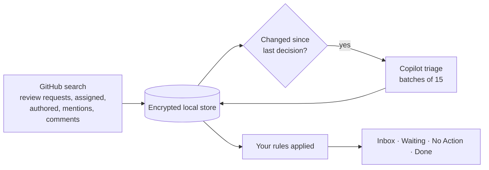

# Triage

**Your GitHub work, prioritized by Copilot.** Triage is a native macOS app that finds every issue and pull request that involves you in an organization, asks GitHub Copilot what needs your attention and why, and gives you a calm, keyboard-driven Inbox of exactly that.

It is private by design: your data stays on your Mac in an encrypted database, Triage never changes anything on GitHub, and there is no telemetry.

> Native macOS 26 · Swift 6 · SwiftUI · Apple silicon and Intel

---

## Highlights

- **An Inbox you can trust.** Only work that needs your action or is worth a look. Everything else is sorted into *Waiting on Others* and *No Action Needed*.
- **Specific calls to action.** Every item says what to do and why now: *“@bob has waited 3 days for your review; CI is green.”*
- **Knows when you've handled it.** Comment, review, or push, and Copilot checks whether you completed its suggested step. Done work comes back only when someone *else* responds.
- **Your rules win.** Mute noisy repos or bots, keep critical work in the Inbox, and tell Copilot what matters to you in plain English.
- **Fast and fluid.** Mail-style keyboard navigation, instant Done and Snooze, live updates as Copilot works.
- **Private and read-only.** Encrypted local storage, Keychain credentials, no analytics, no GitHub writes.

## How it works



1. **Find.** On every refresh, Triage runs a handful of GitHub searches scoped to you (review requests, assignments, your PRs, recent mentions and comments). No organization-wide crawling.
2. **Store.** Results are saved in an encrypted SQLCipher database. The list appears immediately from saved data.
3. **Decide.** Only new or changed items go to Copilot, most urgent first. Copilot returns a disposition, priority, summary, next step, and reason for each.
4. **Apply your rules.** Hard rules are applied on top of Copilot's decision, instantly and deterministically.
5. **Repeat** on your chosen interval, or when you press ⌘R.

## Using Triage

### Sections

| Section | What's in it |
|---|---|
| **Inbox** | Needs your action (●) or worth a look (○), ordered by Copilot's priority. |
| **Waiting on Others** | The next move belongs to someone else. |
| **No Action Needed** | FYI, stale, or informational. |
| **Analyzing** | Copilot's queue: new work, items being re-checked after new activity, and retries. |
| **Done & Snoozed** | Work you finished, snoozed, or that Triage marked *Handled by You*. Filter by type. |
| **Muted** | Work hidden by your mute rules (appears only when non-empty). |

Each row reads top to bottom in order of importance: **repository, number, and why it's yours**, then the **title**, then **Copilot's next step**, then any **blockers** (conflicts, failing checks, changes requested).

Select an item to see the full recommendation, pull request status, people, the formatted description, and recent activity. Click **Not right?** to teach Triage with a rule.

### Keyboard

| Action | Keys |
|---|---|
| Next / previous item | ↓ ↑ or J K, ⌘] ⌘[ |
| Mark done (restore in Done) | E or ⌫, ⌘E |
| Snooze until tomorrow | S, ⇧⌘S |
| Open on GitHub | ↩ or ⌘O |
| Switch section | ⌘1 – ⌘6 |
| Refresh | ⌘R |
| Settings | ⌘, |

Marking done or snoozing moves selection to the next item instantly.

## Copilot, rules, and instructions

Triage uses **two layers** you control, on top of a fixed built-in policy:

| Layer | What it does | When it applies |
|---|---|---|
| **Rules** | *When* repository / author / label / relationship / type / title matches → *then* Mute, Always Inbox, Needs Action, Waiting, No Action, Raise or Lower Priority. | Instantly, always. Rules override Copilot. Mute also stops the item being sent to Copilot. |
| **Instructions** | Plain-English guidance, e.g. *“Production incidents matter more than refactors.”* Up to 2,000 characters. | On the next analysis. Copilot re-checks affected work in the background. |

Create rules from **Settings ▸ Rules**, by right-clicking any item (**Create Rule**), or with **Not right?** on a recommendation. The recommendation shows which rules applied and how your instructions changed the decision.

The built-in prompt is intentionally not editable: it enforces the output format, treats GitHub content as untrusted (so text in an issue can't change your instructions), and improves with app updates. See [Architecture › Prompting](Documentation/ARCHITECTURE.md#prompting).

### Handled detection

When you act on an Inbox item (comment, review, or push), Copilot receives its previous next step plus what you did, and decides whether you handled it:

- **Handled** → moved to Done, labeled **Handled by You** with the evidence (*“You approved the PR and replied to @bob”*) and **Move Back to Inbox**.
- **Partially handled** → stays in the Inbox with an updated next step.

Your own activity never brings done work back; a reply, review, or push from someone else does. Turn automatic handling off in **Settings ▸ Inbox**.

## Settings

| Page | Options |
|---|---|
| **General** | Open at login · Show in menu bar · Refresh every 2/5/10/15/30 min, hourly, or manually · Refresh when Triage becomes active · Last and next refresh · Keyboard reference |
| **Inbox** | Default sort and order · *Later Today* length · *Tomorrow* time · Mark work done when you handle it |
| **Accounts** | Connected GitHub accounts, connection status, add and remove |
| **Organizations** | Which organization's work to show |
| **Copilot** | Status, account, runtime · Use Copilot for this organization · Model · Re-analyze all |
| **Rules** | Hard rules and Instructions for Copilot, per organization |
| **Privacy & Data** | What stays local and what's sent to Copilot · Local data size · Show in Finder |
| **Updates** | Automatic checks and installs · Check now |
| **About** | Version and components |

## Privacy and security

- **Local-first.** Work, decisions, rules, and instructions live in a SQLCipher database whose key is in your Keychain. Work not seen for 30 days is pruned.
- **Read-only.** Triage only reads from GitHub. It never comments, approves, merges, or edits.
- **Copilot is opt-in per organization.** When on, Copilot receives titles, descriptions, recent comments, pull request status, and your instructions for work involving you, through an isolated helper process with no tools, files, or network beyond the Copilot runtime.
- **No telemetry.** No analytics, tracking, advertising, or crash uploads.
- **Signed updates.** Developer ID signed, notarized, and Sparkle EdDSA-verified.

## Getting started

1. Download and open Triage (macOS 26 or later).
2. **Connect GitHub** with your browser, or a personal access token.
3. Pick an organization. Your work appears within about a minute.
4. In **Settings ▸ Copilot**, turn on Copilot for the organization and connect. Copilot then prioritizes your work in the background.

Requires a GitHub account with GitHub Copilot access for AI prioritization.

## Building from source

Requires Xcode 26, [XcodeGen](https://github.com/yonaskolb/XcodeGen), and a Rust toolchain (for the Copilot helper).

```sh
xcodegen generate          # regenerate the project after adding or removing files
open Triage.xcodeproj
scripts/verify-ci.sh       # the full CI gate: build, Swift and Rust tests, packaging checks
```

`swift test` runs the Swift tests from the command line via `Package.swift`, which mirrors the app target. The Xcode project is the shipping definition.

### Project layout

| Path | Contents |
|---|---|
| `Triage/Core` | Contracts, GitHub discovery, encrypted store, Copilot decider, engine, rules, presentation |
| `Triage/Views` | SwiftUI: workspace, detail, rules, settings, onboarding, menu bar |
| `Triage/Models` | App state, navigation, preferences |
| `Triage/CopilotXPC`, `TriageCopilotXPC`, `TriageCopilotHelper` | The sandboxed Copilot boundary (Swift XPC service and Rust helper) |
| `Triage/Database`, `Triage/GitHub`, `Triage/Authentication` | Vaults and schema, GitHub clients, account connection |
| `TriageTests`, `TriageUITests` | Unit and UI tests |
| `scripts`, `.github/workflows` | Verification and fail-closed release automation |

## Documentation

- [Architecture](Documentation/ARCHITECTURE.md): how the pieces fit, data model, prompting, observability
- [Releasing](Documentation/RELEASING.md): signing, notarization, Sparkle, and release automation
- [Performance](Documentation/PERFORMANCE.md): expected timings and how to measure them
- [Release notes](Documentation/RELEASE_NOTES.md)
- [Handoff](Documentation/HANDOFF.md) and [AGENTS.md](AGENTS.md): guidance for contributors and coding agents
