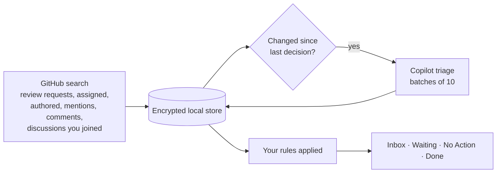

# Triage

**Your GitHub work, prioritized by Copilot.** Triage is a native macOS app that finds the issues, pull requests, and discussions that involve you in an organization, asks GitHub Copilot what needs your attention and why, and gives you a calm, keyboard-driven Inbox of exactly that.

It is private by design: your data stays on your Mac in an encrypted database, Triage never changes anything on GitHub, and there is no telemetry.

> Native macOS 26 · Swift 6 · SwiftUI · Apple silicon and Intel

---

## Highlights

- **An Inbox you can trust.** Only work that needs your action or is worth a look. Everything else is sorted into *Waiting on Others* and *No Action Needed*.
- **Specific calls to action.** Every item says what to do and why now: *“@bob has waited 3 days for your review; CI is green.”*
- **Knows when you've handled it.** Comment, review, or push, and Copilot checks whether you completed its suggested step. Done work comes back only when someone *else* responds.
- **Your rules win.** Mute noisy repos or bots, keep critical work in the Inbox, and tell Copilot what matters to you in plain English.
- **Start the day with a Briefing.** What needs you, what's waited longest, quick wins, follow-ups to nudge, and what you finished today. End the week with a Weekly Review.
- **Get through it fast.** Focus mode works through a list one item at a time, Copilot drafts replies in your voice for you to edit and post, and effort estimates surface the quick wins.
- **Fast and fluid.** Mail-style keyboard navigation, saved searches, instant Done and Snooze, notifications and a Dock badge for what needs you.
- **Private and read-only.** Encrypted local storage, Keychain credentials, no analytics, no GitHub writes.

## How it works



1. **Find.** On every refresh, Triage runs a handful of GitHub searches scoped to you (review requests, assignments, your PRs, recent mentions and comments, and discussions you opened or commented on). No organization-wide crawling. Watched discussions you haven't joined stay on GitHub.
2. **Store.** Results are saved in an encrypted SQLCipher database. The list appears immediately from saved data.
3. **Decide.** Only new or changed items go to Copilot, most urgent first. Copilot returns a disposition, priority, summary, next step, and reason for each.
4. **Apply your rules.** Hard rules are applied on top of Copilot's decision, instantly and deterministically.
5. **Repeat** on your chosen interval, or when you press ⌘R.

## Using Triage

### Briefing and Weekly Review

**Briefing** (⌘0) is the overview for the start of your day: counts of what needs your action, quick wins, and overdue follow-ups, then cards for *Needs Your Action*, *Waiting on You Longest*, *Quick Wins*, *Follow Up* (waiting on others with no movement), *New Since Yesterday*, and *Handled Today*. **Focus on What Needs You** works through the action items one at a time.

**Weekly Review** (⌘9) shows what you got through in the last 7 days, open work by repository, what's waited on you longest, and work that has gone quiet.

Both fill the window. Clicking an item opens it in its list with its details; **Show All** and the headline numbers open the filtered list behind them. **Back** and **Forward** (⌘[ ⌘]) return you, like Finder.

### Sections

| Section | What's in it |
|---|---|
| **Inbox** | Needs your action (●) or worth a look (○), ordered by Copilot's priority. |
| **Waiting on Others** | The next move belongs to someone else. |
| **No Action Needed** | FYI, stale, or informational. |
| **Analyzing** | Copilot's queue: new work, items being re-checked after new activity, and retries. |
| **Snoozed** | Work hidden until the time you chose; it returns sooner if someone responds. |
| **Done** | Work you finished or that Triage marked *Handled by You*. Filter by how it was finished. |
| **Muted** | Work hidden by your mute rules (appears only when non-empty). |

A **blue dot** means unread: you haven't viewed the item since someone else last commented, reviewed, or pushed. Your own activity never marks work unread. An **orange flag** means Copilot says it needs your action. The Inbox shows how many items it holds, and any list with unread work adds a blue unread count. Times are compact (`25m`, `2h`, `5d`, `3mo`); hover for the exact date.

**Select several items** with ⌘-click, ⇧-click, or ⌘A to mark them done, snooze, restore, mark read or unread, open them on GitHub, or work through them in Focus, from the right-click menu, the Item menu, the keyboard, or the summary that replaces the detail panel.

Each row reads top to bottom in order of importance: **repository, number, and why it's yours**, then the **title**, then **Copilot's next step**, then any **blockers** (conflicts, failing checks, changes requested).

Select an item to see the full recommendation (including Copilot's effort estimate: *Quick*, *Under an hour*, or *Deep work*), pull request status, people, related work it references or is referenced by, the formatted description, and recent activity. **Group By** in the sort menu groups any list by effort, repository, or why it's yours.

### Focus

Focus (⇧⌘F, or the target button above the list) shows one item at a time from the current list. **J**/**K** move, **E** marks done, **S** snoozes until tomorrow, **O** opens on GitHub, and **Esc** exits. Items you finish anywhere drop out of the queue.

### Draft Reply

**Draft Reply…** (⌥⌘D) asks Copilot for a reply that accomplishes the item's next step, written as you and in your writing style. Edit it, then **Copy** or **Copy and Open on GitHub**. Triage never posts for you; bracketed placeholders such as *[ETA]* mark details only you can supply.

### Search

The search field at the top of the list filters instantly (⌘F). Type words to match titles, descriptions, people, labels, and Copilot's notes, or use GitHub-style filters:

`repo:` `author:` `label:` `team:` · `is:pr` `is:issue` `is:draft` `is:review` `is:direct` `is:team` `is:assigned` `is:mine` `is:mentioned` `is:action` `is:unread` `is:read` · `status:conflicts` `status:failing` `status:approved` `status:changes` · `priority:high` · `effort:quick` `effort:short` `effort:deep`

**Save** keeps the current search in the sidebar as a saved search that stays up to date across all your work. Type in the search field to narrow it further; right-click it to rename or delete.

Or pick filters from the **Filter** menu (⊜) beside the field; applied filters appear as chips you can click to remove. While searching, choose **This Section** or **All Work**; results across all work show which section they're in. Press **Esc** to clear the search, and Esc again (or Return) to go back to the list.

### Keyboard

| Action | Keys |
|---|---|
| Next / previous item | ↓ ↑ or J K, ⌥⌘↓ ⌥⌘↑ |
| Back / forward | ⌘[ ⌘] |
| Briefing / Weekly Review | ⌘0 / ⌘9 |
| Focus on the current list | ⇧⌘F |
| Draft reply | ⌥⌘D |
| Mark done (restore in Done) | E or ⌫, ⌘E |
| Snooze until tomorrow | S, ⇧⌘S |
| Mark as read or unread | U, ⇧⌘U |
| Mark all as read | ⌥⇧⌘U |
| Open on GitHub | ↩ or ⌘O, or double-click |
| Select several | ⌘-click, ⇧-click, ⇧↓ ⇧↑, ⌘A |
| Switch section | ⌘1 – ⌘7 |
| Refresh | ⌘R |
| Search | ⌘F |
| Create rule from item | ⌥⌘R |
| Settings | ⌘, |

Marking done or snoozing moves selection to the next item instantly.

## Copilot, rules, and instructions

Triage uses **two layers** you control, on top of a fixed built-in policy:

| Layer | What it does | When it applies |
|---|---|---|
| **Rules** | *When* conditions match → *then* Mute, Always Inbox, Needs Action, Waiting, No Action, Raise or Lower Priority. | Instantly, always. Rules override Copilot. Mute also stops the item being sent to Copilot. |
| **Instructions** | Plain-English guidance, e.g. *“Production incidents matter more than refactors.”* Up to 2,000 characters. | On the next analysis. Copilot re-checks affected work in the background. |

Rule conditions (all must match):

| Condition | Examples |
|---|---|
| My relationship | Review requested from me **directly** or from **my team only**, assigned, opened by me, mentions me, I commented |
| Requested team | `core` or `octo/core` |
| Pull request status | Draft, ready for review, approved, changes requested, checks failing, has conflicts |
| Repository, author, label | `octo/widgets`, `octo/*`, `dependabot[bot]`, `security` |
| Type, title contains | Issue, pull request, draft pull request; any text |
| No updates for | At least *N* days, for stale work |

For example, *“My relationship is review requested from my team only → Lower priority”* keeps team-wide review requests from crowding out the ones addressed to you.

Create a rule from any item with **Create Rule…** (detail view, right-click, or ⌥⌘R), or **Not right?** on a recommendation, which suggests moving it elsewhere. Both open the same editor with conditions suggested from the item as checkboxes and a live preview of what the rule matches. Manage all rules in **Settings ▸ Rules**. The recommendation shows which rules applied and how your instructions changed the decision.

The built-in prompt is intentionally not editable: it enforces the output format, treats GitHub content as untrusted (so text in an issue can't change your instructions), and improves with app updates. See [Architecture › Prompting](Documentation/ARCHITECTURE.md#prompting).

### Handled detection

When you act on an Inbox item (comment, review, or push), Copilot receives its previous next step plus what you did, and decides whether you handled it:

- **Handled** → moved to Done, labeled **Handled by You** with the evidence (*“You approved the PR and replied to @bob”*) and **Move Back to Inbox**.
- **Partially handled** → stays in the Inbox with an updated next step.

Your own activity never brings done work back; a reply, review, or push from someone else does. Turn automatic handling off in **Settings ▸ Inbox**.

## Settings

Open with ⌘, or **Settings** at the bottom of the sidebar.

| Tab | Options |
|---|---|
| **General** | Open at login · Show in menu bar · Show on launch (Briefing, Inbox, or where you left off) · Show scroll bars · Refresh every 2/5/10/15/30 min, hourly, or manually · Refresh when Triage becomes active · Privacy and local data · Keyboard reference |
| **Inbox** | Default sort and order · *Later Today* length · Morning snooze time (Tomorrow, In 3 Days, Next Week, In 7 Days) · When to suggest a follow-up · Mark work done when you handle it · Mark items as read immediately, after 2 seconds, or only manually |
| **Notifications** | Notify when work newly needs your action · Daily follow-up reminder · Quiet hours · Dock badge |
| **Accounts** | Connected GitHub accounts, their status, and when each personal access token expires · Replace a token in place · Which organization's work to show |
| **Copilot** | Status, account, runtime · Use Copilot for this organization · Model, reasoning effort, and long context (offered when the model supports them) · Re-analyze all · Draft Replies: the same model or a separate one, and your writing style |
| **Rules** | Hard rules and Instructions for Copilot, per organization |
| **Updates** | Automatic checks and installs · Current version · Check now |

## Privacy and security

- **Local-first.** Work, decisions, rules, and instructions live in a SQLCipher database whose key is in your Keychain. Work not seen for 30 days is pruned.
- **Read-only.** Triage only reads from GitHub. It never comments, approves, merges, or edits.
- **Copilot is opt-in per organization.** When on, Copilot receives titles, descriptions, recent comments, pull request status, and your instructions for work involving you, through an isolated helper process with no tools, files, or network beyond the Copilot runtime.
- **No telemetry.** No analytics, tracking, advertising, or crash uploads.
- **Signed updates.** Developer ID signed, notarized, and Sparkle EdDSA-verified.

## Getting started

Download and open Triage (macOS 26 or later). The Setup Assistant walks you through everything in about two minutes:

1. **GitHub.** Connect with your browser, or a personal access token (see [GitHub access](#github-access)).
2. **Organization.** Choose whose work to show.
3. **Copilot.** Allow Copilot for the organization, install the verified runtime, and sign in.
4. **Notifications.** Allow notifications and the Dock badge, and choose what you hear about.
5. **Your Mac.** Open at login, the menu bar, and how often to check GitHub.

Only GitHub and an organization are required; everything else can be set up later in Settings. Run the assistant again anytime from **Help ▸ Setup Assistant**. When you finish, Triage opens your Briefing.

Requires a GitHub account with GitHub Copilot access for AI prioritization.

### GitHub access

Triage only reads from GitHub; it never posts, comments, or changes anything. Copilot signs in separately, so the token below is used only to find your work. The token sheet links to GitHub's token page with this access already selected.

| Token | What to select |
|---|---|
| **Fine-grained** (recommended) | Resource owner: your organization (it must allow fine-grained tokens, and may need to approve yours). Repository access: all repositories, or the ones you work in. Repository permissions, read-only: Metadata, Issues, Pull requests, Commit statuses, Contents. Organization permissions, read-only: Members. |
| **Classic** | Scopes `repo` and `read:org`. Classic tokens have no read-only scope for private repositories. If your organization uses SAML single sign-on, authorize the token for it. |

Triage shows each token's expiration in **Settings ▸ Accounts**, warns you a week before it expires, and lets you replace it without removing the account.

## Building from source

Requires Xcode 26, [XcodeGen](https://github.com/yonaskolb/XcodeGen), and a Rust toolchain (for the Copilot helper).

```sh
xcodegen generate          # regenerate the project after adding or removing files
open Triage.xcodeproj
scripts/verify-ci.sh       # the full CI gate: build, Swift and Rust tests, packaging checks
```

`swift test` runs the Swift tests from the command line via `Package.swift`, which mirrors the app target. The Xcode project is the shipping definition.

### Project layout

| Path | Contents |
|---|---|
| `Triage/Core` | Contracts, GitHub discovery, encrypted store, Copilot decider, engine, rules, presentation |
| `Triage/Views` | SwiftUI: workspace, detail, rules, settings, onboarding, menu bar |
| `Triage/Models` | App state, navigation, preferences |
| `Triage/CopilotXPC`, `TriageCopilotXPC`, `TriageCopilotHelper` | The sandboxed Copilot boundary (Swift XPC service and Rust helper) |
| `Triage/Database`, `Triage/GitHub`, `Triage/Authentication` | Vaults and schema, GitHub clients, account connection |
| `TriageTests`, `TriageUITests` | Unit and UI tests |
| `scripts`, `.github/workflows` | Verification and fail-closed release automation |

## Documentation

- [Architecture](Documentation/ARCHITECTURE.md): how the pieces fit, data model, prompting, observability
- [Releasing](Documentation/RELEASING.md): signing, notarization, Sparkle, and release automation
- [Performance](Documentation/PERFORMANCE.md): expected timings and how to measure them
- [Release notes](Documentation/RELEASE_NOTES.md)
- [Handoff](Documentation/HANDOFF.md) and [AGENTS.md](AGENTS.md): guidance for contributors and coding agents
